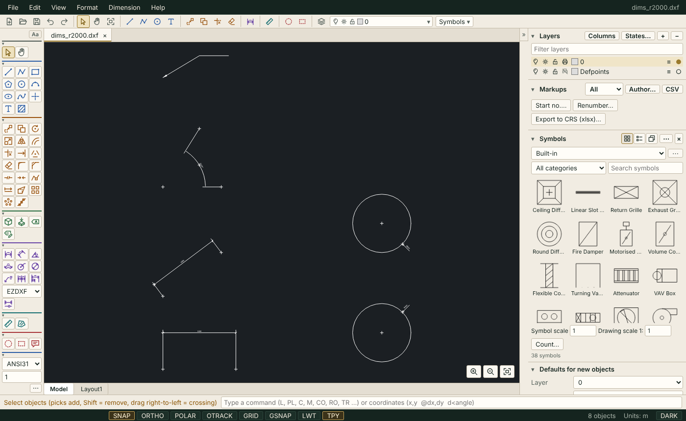

# ASH Draw Studio

A free, MIT-licensed drawing viewer and editor for Windows that opens, edits and saves
DXF drawings, with DWG file support through the separately bundled LibreDWG converters.
Built with Electron by ASH Technical & Project Management Services (ASH PMCS).

<p>
  <a href="https://github.com/abbas437/ash-draw/releases/latest"></a>
  <a href="https://github.com/abbas437/ash-draw/releases/latest"></a>
  <a href="LICENSE"></a>
</p>

**[Download the latest version](https://github.com/abbas437/ash-draw/releases/latest)** (installer, portable .exe or zip, no admin rights needed) ·
[Download page on ashdesignsuite.com](https://ashdesignsuite.com/studio/#draw) ·
[User guide](https://ashdesignsuite.com/help/draw-studio/)



## Features

- **Open** DXF (ASCII, R12 to R2018) and DWG drawings; drag-and-drop, File > Open, or "Open with" from Explorer.
- **View**: wheel zoom, middle-mouse or Space + drag to pan, zoom to fit, light theme by default with an optional dark theme (View > Dark theme, remembered), the drawing background follows the theme and can be switched on its own, optional lineweights.
  Layers, colours (ACI and true colour), linetypes, blocks and block arrays, hatches (solid and common patterns), text and
  multiline text, splines, ellipses, dimensions (as drawn) and leaders are displayed.
- **Draw**: line, polyline, rectangle, circle, arc (3 points), ellipse, point, text, hatch (click inside a closed shape).
- **More draw commands**: POLYGON (inscribed, circumscribed or by edge), SPLINE (through fit points, open or closed) and DONUT (filled ring).
- **Construction lines**: XLINE (XL; through a point, Hor, Ver, Ang, Bisect, Offset) and RAY; each command run is one undo step.
- **Divide / measure**: DIVIDE (DIV) places points or blocks at N equal divisions of a line, arc, circle, ellipse, polyline or spline; MEASUREPOINTS (ME, AutoCAD's point-placing MEASURE) places them every given length from the picked end.
- **Modify**: move, copy, rotate, scale, mirror, offset, trim, extend, explode, erase; copy/paste; unlimited undo and redo.
- **Align** (AL): move, rotate and optionally scale objects so source points land on destination points (2D AutoCAD LT ALIGN, one undo step).
- **Center marks / centerlines**: DIMCENTER (DCE) marks the centre of arcs and circles per the dimension style's DIMCEN (negative adds extension lines); CENTERMARK (CM) always adds them; CENTERLINE draws the mid / bisecting axis of two lines (CENTER linetype when loaded). Plain lines (not associative), one undo step per command.
- **Draw order** (DR / DRAWORDER, TEXTTOFRONT, HATCHTOBACK): bring objects to front, send to back, or above/under reference objects; read from the DWG/DXF draw-order table and saved as entity order (one undo step).
- **Polyline editing**: PEDIT (Close/Open, Join, Width, Fit, Spline, Decurve, Reverse, Multiple), REVERSE and BREAKATPOINT; PEDIT Edit vertex comes later.
- **Select**: as in AutoCAD, each pick or window adds to the selection and Shift+pick (or Shift+window) removes; Esc clears.
- **Precision**: object snaps (endpoint, intersection, midpoint, centre, quadrant, node, insertion, perpendicular),
  ortho and polar tracking, and an AutoCAD-style command line (`L`, `PL`, `C`, `M`, `CO`, `RO`, `TR` ... and typed
  coordinates such as `10,20`, `@5,0`, `@10<45`).
- **Command line**: ZOOM (All/Extents/Window/Previous/Object, nX), ID (point coordinates), LIST (object geometry in drawing units, with Copy), LTSCALE (undoable), REGEN/RE, and PR/LA to show the Properties or Layers panel.
- **Command history**: the last 3 lines show above the prompt bar (inputs with their prompts, ID / LIST results, errors; last 500 lines per window); F2 or View > Command history opens a scrollable panel with Copy; Up/Down in the empty command line recall earlier inputs.
- **Layers and properties** panels, including layer on/off and lock, colour, linetype and lineweight; measure tool.
- **Select and clean up**: QSELECT (Quick Select by object type, property, operator and value), SELECTSIMILAR (same type and layer), PURGE (unused blocks, layers, linetypes, text and dimension styles, with nested items and zero-length geometry; one undo step).
- **Arc length dimension**: DIMARC (DAR) dimensions an arc or a polyline arc segment (`⌒` before the length; one undo step); ARC_DIMENSION entities are read, drawn, moved and saved.
- **Jogged radius dimension**: DIMJOGGED (DJO) dimensions a large arc or circle from an override centre with a jogged leader (one undo step); LARGE_RADIAL_DIMENSION entities are read, drawn, moved and saved.
- **Save and convert**: DXF (R2000, lossless for everything the program supports), DWG (experimental, verified after saving),
  and export to PDF (vector), SVG and PNG.

## Download and install

Windows 10 or 11, 64-bit (x64). Each release provides two builds:

| File | Use |
|---|---|
| `ASH-Draw-Studio-Setup-<version>.exe` | Installer (per-user, no admin rights needed). Adds Start menu/desktop shortcuts and registers ASH Draw Studio as an available "Open with" program for `.dxf` and `.dwg`. It never makes itself the default program silently; choose that yourself in Settings > Apps > Default apps. |
| `ASH-Draw-Studio-Portable-<version>.exe` | Portable build: runs without installing and keeps its settings next to the .exe. No file-type registration. |

`SHA256SUMS.txt` on each release lists the SHA-256 of both executables.

The executables are not code-signed yet, so Windows SmartScreen shows a warning
("Windows protected your PC") on first run. Check the SHA-256 against `SHA256SUMS.txt`,
then choose **More info > Run anyway**.

## Build from source

Requirements: Node.js 22 or later and npm. Building the Windows installer requires Windows
(or a CI runner such as `windows-latest`).

```sh
npm ci
npm start               # run the app in development
npm test                # unit tests (test/**)
npm run test:electron   # main-process tests (electron/**/*.test.mjs)
npm run dist            # fetch + verify LibreDWG, vendor, notices, build Setup + Portable .exe into dist/
```

`npm run dist` runs `scripts/fetch-libredwg.mjs`, which downloads the official LibreDWG 0.14.8597
Windows x64 archive, refuses it unless its SHA-256 matches the pinned value, and extracts only
`dwg2dxf.exe`, `dxf2dwg.exe`, `libredwg-0.dll` and `libiconv-2.dll` into `build/libredwg/` together with the GPL
text (`COPYING`) and `README-SOURCE.txt`. `node scripts/fetch-libredwg.mjs --source <dir>`
additionally downloads and verifies the LibreDWG source tarball. Release builds instead use converters patched for large drawings (`tools/libredwg-win/build-patched.sh`, built by CI);
to use such a zip locally set `ASH_LIBREDWG_ZIP=<path to libredwg-0.14.8597-llp64-win64.zip>` (or pass `--from <zip>`). `npm run licenses` regenerates
`THIRD-PARTY-NOTICES.md` and fails if an npm production dependency has a non-permissive licence.
`npm run icon` regenerates `build/icon.png` (original artwork).

### Releases

Releases are built by GitHub Actions (`.github/workflows/build.yml`): every push to `main`
builds the patched LibreDWG converters on `ubuntu-latest` (mingw-w64), then builds and tests on
`windows-latest` and uploads the two .exe files, `SHA256SUMS.txt` and the LibreDWG source tarball,
patch and build scripts as workflow artifacts; pushing a tag `v*` additionally creates a GitHub
Release with those files attached. A separate `ubuntu-latest` job runs the unit tests.
After a release, `node scripts/winget-manifest.mjs <version> SHA256SUMS.txt` writes the Windows Package Manager
manifests to `winget/manifests/`; `winget/README.md` explains how to test and submit them.

## The `window.api` contract

The renderer runs sandboxed with context isolation and no Node.js access. Everything it may
do outside the page goes through `window.api`, exposed by `electron/preload.js`. All methods
except `isElectron` and `onOpenFile` return Promises. File reads and writes are limited to
paths the user chose in a dialog or passed on the command line during this session.

| Member | Purpose |
|---|---|
| `isElectron` | `true` when running inside the desktop app. |
| `version()` | Application version. |
| `openFiles(opts)` | Show the Open dialog (optional filters); returns the chosen files. |
| `readFile(path)` | Read a granted file's bytes. |
| `xrefRead(hostPath, refPath)` / `imageRead(hostPath, refPath)` | Find and read an external reference / raster image of an open drawing. Files in the drawing's folder (or below it) are read; any other path, including UNC and mapped-drive paths, comes back as `{refused, declined}` without being touched until the user agrees. |
| `refsDecide(hostPath, load, paths)` | The answer to "This drawing refers to files outside its folder": Load (only the refused paths listed) or Don't load (for that drawing, for the session). |
| `saveFile(opts)` | Show the Save dialog (default path, filters); returns the chosen path. |
| `writeFile(path, bytes)` | Write bytes to a granted path. |
| `getLaunchFiles()` | Files passed on the command line / "Open with" at start-up. |
| `onOpenFile(cb)` | Subscribe to files opened later (second instance); returns an unsubscribe function. |
| `print(pdfBytes)` | Print a PDF (a plot) through the system print dialog; the app window itself is never printed. |
| `setTitle(title)` | Set the window title. |
| `showItem(path)` | Show a granted file in Explorer. |
| `settingsGet(key)` / `settingsSet(key, value)` | Read / write a persisted setting. |
| `sessionUpdate({files, active})` | Report the open drawings' paths; main keeps only granted paths and adds new ones to the recent list. |
| `sessionInfo()` / `sessionRestore()` / `sessionDismiss()` | Start-up mode (`startup.mode`: `ask`, `restore`, `new`) and the offer to reopen the last session; reopen it (`{files, active, missing}`) or decline. |
| `recentList()` / `recentOpen(path)` / `recentClear()` | The last 15 files (`exists` per entry); reopen one (null when it no longer exists); clear the list. |
| `dwgAvailable()` | Whether the LibreDWG converters are present and usable. |
| `dwgToDxf(bytes)` | Convert DWG bytes to DXF via `dwg2dxf.exe`. |
| `dwgOpen(pathOrBytes)` | Open a DWG: main converts it (from a granted path, or from bytes) and returns `{url, size, warnings, engine}`; the DXF reader worker fetches the one-time `app://drawstudio/_open/<token>` URL, so the DXF is not cloned through IPC on the window thread. |
| `dxfToDwg(dxfBytes, version)` | Convert DXF bytes to DWG via `dxf2dwg.exe`; `version` is `'r2000'` or `'r14'`. |
| `symbolsAddFolder()` | Choose a symbol library folder in the folder dialog; main stores it (`symbol-folders.json`) and returns `{id, path, name, files, truncated}` (null when cancelled). |
| `symbolsFolders()` / `symbolsRemoveFolder(id)` | The stored folders `[{id, path, name}]`; forget one. |
| `symbolsList(id)` | `{files: [{rel, name, category, size, mtimeMs}], truncated}`: the .dxf/.dwg files under a stored folder. |
| `symbolsRead(id, rel)` | A listed file as DXF `{name, format: 'dxf', sourceFormat, bytes}` (a DWG is converted). |
| `symbolsThumbGet(id, rel)` / `symbolsThumbPut(id, rel, png)` | The cached PNG thumbnail (or null) / cache one (a PNG of at most 256 KB); keyed by the file's path, mtime and size. |

## Licence

ASH Draw Studio is free software under the MIT licence (see `LICENSE`).
Copyright (c) 2026 ASH Technical & Project Management Services (ASH PMCS).

Third-party components are listed with their licence texts in `THIRD-PARTY-NOTICES.md`
(shipped in the installation's `resources` folder). npm runtime dependencies are MIT
(pdf-lib, @pdf-lib/fontkit; pako is MIT AND Zlib). Electron is MIT; its Chromium
notices ship as `LICENSES.chromium.html` in the installation folder.

**LibreDWG.** DWG support uses GNU LibreDWG 0.14.8597 (libredwg), which is licensed under the
GPL-3.0-or-later. ASH Draw Studio does not link to or load LibreDWG: the programs
`dwg2dxf.exe` and `dxf2dwg.exe` (release builds are built from upstream source with one patch, see below; `README-SOURCE.txt` states which build a copy contains) (with `libredwg-0.dll` and GNU libiconv's LGPL `libiconv-2.dll`) are shipped in
`resources/libredwg/` and started as separate processes (`execFile`, no shell) that convert
through temporary files. They keep their own licence; the GPL text is in
`resources/libredwg/COPYING`. The complete corresponding source is the LibreDWG 0.14.8597
release, available from https://github.com/LibreDWG/libredwg/releases/tag/0.14.8597 and
https://github.com/LibreDWG/libredwg/releases/download/0.14.8597/libredwg-0.14.8597.tar.xz, and the same tarball
(`libredwg-0.14.8597.tar.xz`) is attached to every ASH Draw Studio GitHub Release, together with the
patch and build scripts from `tools/libredwg-win/` that complete the corresponding source.
`resources/libredwg/README-SOURCE.txt` contains a written offer for the source.
GPL source offer contact: https://github.com/abbas437/ash-draw/issues

DWG is used here only as the descriptive name of a file format. ASH Draw Studio is not
affiliated with or endorsed by Autodesk. See `docs/COPYRIGHT-REVIEW.md`.

## Help

The user guide is built into the app: press F1 or use Help ▸ User guide (search, guided tours, and "Show me" links that
point at the real buttons). The same guide is published on https://ashdesignsuite.com. Its sources are in `help/`
(`npm run help:build`, `npm run help:shots`).

## Limitations

Please read these before relying on the program for important work.

- **Layouts and viewports** are read, edited and saved back; viewport clip boundaries are drawn and kept.
- **Objects not shown or not saved**: 3D solids, bodies and regions are not shown; proxy and other custom objects are drawn from
  their saved graphics but cannot be edited (Save as DXF keeps proxy objects). Skipped objects are reported when a file opens and
  before a save. Help ▸ "What this program can and cannot do" in the app has the full list.
- **Dimensions** are displayed from their stored drawing and can be moved, copied and exploded, but not edited as dimensions.
- **DWG** is read through the built-in LibreDWG converter or, when installed, the free ODA File Converter. Saving as DWG needs
  the ODA File Converter (AutoCAD 2000–2018 formats); without it, DWG saving is experimental and off by default (Edit ▸
  Preferences), and text rotation and some hatches can be lost. DXF is the reliable format.
- **Autodesk SHX fonts are not available**; text is drawn with system fonts, so spacing and appearance differ from the original.
- **PDF export** draws Latin, Greek, Cyrillic and Arabic text; Chinese, Japanese and Korean characters cannot be drawn yet. Everything else is vector.
- **Binary DXF** is not supported; save as ASCII DXF.
- **Unsigned executables**: Windows SmartScreen warns on first run (see above).

Developer documentation of the drawing engine: `docs/CORE-API.md`. Tests: `npm test` (unit), `npm run test:e2e`
(headless browser UI test; needs Chromium and `node scripts/vendor.js`), and `test/e2e/electron.mjs` (the real desktop app,
needs a display).

## Support

Bug reports, questions and requests (including the GPL source offer): https://github.com/abbas437/ash-draw/issues

The ASH logo and icon are trademarks of ASH Technical & Project Management Services and are not covered by the MIT licence of this repository. You may not use them for other products.
